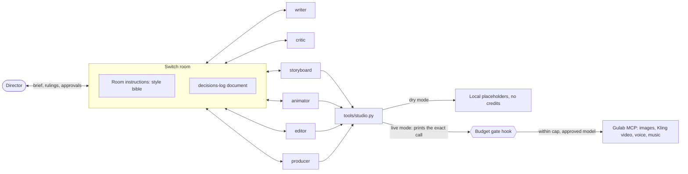

# Film Crew Room

One person directs a crew of AI agents that make short Kannada-narrated reels, working together in a [Switch](https://docs.switchagents.ai/switch-rooms/getting-started) room.

Built for the Flip the Switch hackathon, Best Personal or Creative Workflow track.

## The problem
A regional-language creator is the writer, artist, editor and producer alone. AI tools help with each job, but they work in silos: every model call starts cold, and no tool knows what you rejected yesterday. Video generation also costs real money, so a bad shot is expensive to find out about.

## What the room does
You post a brief. The crew works in one thread:

| Agent | Job | Who decides |
|---|---|---|
| `writer` | Script and shot list | |
| `critic` | Attacks the script | You rule on disputes |
| `storyboard` | One cheap still per shot | You approve or reject each with a reason |
| `producer` | Logs every ruling, quotes the cost | You approve the spend |
| `animator` | Clips from approved stills only | You approve each paid clip on a permission card |
| `editor` | Voice, music, final cut | |

**Your veto is the budget gate.** Stills cost about $0.10 each and a 5-second clip about $0.67, so you catch problems while they are cheap.

## How Switch is used
Without Switch there is no workflow here, only a command-line tool.

| Switch feature | Role in the crew |
|---|---|
| **Room and threads** | Every agent and the director work in one channel. Handoffs happen by mention, so each agent starts when the last one finishes. |
| **Room instructions** | The style bible and working rules. Every agent gets them on joining ([`crew/ROOM-INSTRUCTIONS.md`](crew/ROOM-INSTRUCTIONS.md)). |
| **Room document** | `decisions-log`: every ruling, with your reason, plus standing rules. It lives in the room, so it outlasts any agent's session. |
| **Permission cards** | The animator runs with Auto mode off, so a paid clip waits for your answer in the room. |
| **Attachments** | Stills and the final cut are reviewed in the thread. |



The agents share this repository for heavy media files in `productions/<slug>/`. Decisions, handoffs and approvals go through the room.

## Run it
Built on macOS (Apple silicon). You need [Docker](https://docs.docker.com/get-started/get-docker/) running, Claude Code signed in (`claude auth login`), Python 3, `ffmpeg` and Pillow (`pip install pillow`).

**1. Check the tools without Switch:**
```bash
python3 -m unittest discover tests
```

**2. Set up Switch.** [Install Switch Console](https://docs.switchagents.ai/switch-rooms/getting-started/install-switch-console), choose **On this computer** and start the local server.

**3. Create the crew.** Add the six agents in [`crew/agents.md`](crew/agents.md), with this repository as each one's Directory.

**4. Create the room.** Under **Your Rooms**, choose **Create room**, pick Mattermost and paste [`crew/ROOM-INSTRUCTIONS.md`](crew/ROOM-INSTRUCTIONS.md) into **Instructions**. Then add all six agents.

**5. Give the crew a brief:**
```text
@writer new production, slug test-01. A 12-second reel: Sita realises the golden deer is a trap.
```
Then rule on what the crew brings you.

## Dry mode and live mode
**Dry mode is the default and costs no credits.** You need no Gulab account. Stills are labelled cards showing the prompt, clips are slow zooms over them, and audio is silent, so the whole workflow runs, including every human gate.

To go live:
1. Connect Gulab as a claude.ai connector on the account Claude Code uses, then check it appears:
   ```bash
   claude mcp list
   ```
2. In `studio.json`, set `"mode": "live"`, set `gulab_board` to a Gulab project id, and add the hosted URL of each `bible/` sheet to `ref_urls`.

**A Claude Code hook guards the money.** [`.claude/settings.json`](.claude/settings.json) runs `studio.py gate` around every paid Gulab tool. It blocks all of them in dry mode, blocks any model `studio.json` doesn't list, and blocks any call that would pass `budget_usd`. If the gate itself fails, the call is blocked too.

Spend is estimated from the listed prices in `rates_usd` and recorded in `productions/ledger.jsonl`, so reconcile it with your Gulab balance.

## Credits
The style bible and character sheets come from my earlier trailer, *Ramayana: The Anklet*. That trailer was not made in this room.
