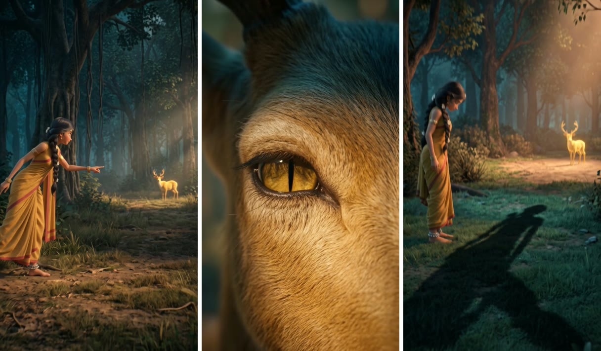

# Film Crew Room

Film Crew Room lets one person make a short film with a crew of AI agents while keeping the final say. The crew is six agents in one [Switch](https://docs.switchagents.ai/switch-rooms/getting-started) chat room. I post an idea, they do the work, and no video gets paid for until I say yes.

Built for the Flip the Switch hackathon, Best Personal or Creative Workflow track.

[](docs/golden-deer.mp4)

**[Watch the demo](https://youtu.be/OdDufmvuamY)** (about 2 minutes) or **[watch the reel](docs/golden-deer.mp4)** (12 seconds, Kannada narration)

## Why I built it

In November 2026 I made a Ramayana trailer, working outside this room. It took 42 video prompts, about 28 hours start to finish, and $22.72 in generation costs.

Two problems stood out. Every prompt had to describe the look from scratch, because a video model remembers nothing between calls. And each generated clip costs real money, so finding a mistake at the video stage is the expensive way to find it.

A real film crew handles this with a shared brief, a script meeting, and a producer who watches the money. I wanted the same setup for one person working in Kannada.

## How the first film got made

This is what happened on *The Golden Deer's Trap*, made in the room on 7 November 2026.

1. **The idea.** I asked for a 12-second reel in which Sita realises the golden deer is a trap.
2. **The script.** The writer drafted three shots, and the critic found a real problem: Sita stands too far away to notice the deer's eye narrowing.
3. **My ruling.** I replied, "narration is better, we must do it outdoors with no habitat/house involved." The writer turned the line into narration and took out the hut. The producer saved my ruling as a standing rule for the crew.
4. **The pictures.** The storyboard artist made one still per shot, at about 14 cents each. I approved all three on the first try.
5. **The bill.** Before any animation, the producer quoted $2.02 and showed what was left of my $5 limit. I approved it.
6. **The animation.** The animator had to ask me in the room before making clips. It can't start on its own.
7. **The final cut.** The editor added Kannada narration and music, then posted the finished reel in the thread.

The whole reel cost about $2.60.

| Shot | Kannada narration | Meaning |
|---|---|---|
| 1 | ಆ ಚಿನ್ನದ ಜಿಂಕೆಯನ್ನು ನೋಡಿ! | Look at that golden deer! |
| 2 | ಇಲ್ಲಿ ಏನೋ ಮೋಸವಿದೆ | There is some deceit here. |
| 3 | ಇದು ಜಿಂಕೆಯಲ್ಲ, ಮಾಯೆ! | This is not a deer, it is an illusion! |

## The crew

| Agent | What they do | Where I step in |
|---|---|---|
| Writer | Writes the script and shot list | |
| Critic | Looks for problems in the script | I settle disagreements |
| Storyboard artist | Makes one cheap still per shot | I approve or reject each one, with a reason |
| Producer | Records my decisions and quotes costs | I approve the spending |
| Animator | Turns approved stills into video clips | I answer a permission request in the room |
| Editor | Adds voice and music, cuts the final film | |

## Why it needs Switch

The media tools are a small script. Switch is what makes these agents a crew:

- **They work in one conversation.** When one agent finishes, it mentions the next one by name, and I can read and step into every handoff.
- **They all get the same brief.** The film's look, the characters and the working rules sit in the room's instructions, so nobody needs them explained again.
- **My decisions live in the room.** The producer keeps them in a room document called `decisions-log`, and agents read it before each job. It stays in the room when an agent's session ends.
- **The animator has to ask first.** With Auto mode off, a request to spend money shows up in the room as a permission card, and the work waits for my answer.
- **I review everything in one place.** Stills and the final cut arrive in the thread as attachments.

## Try it

You can see the pipeline work in about two minutes, with no accounts and no credits. You need Python 3, `ffmpeg` and Pillow.

```bash
git clone https://github.com/githubber-me/flip-the-switch.git
```
```bash
cd flip-the-switch
```
```bash
pip3 install pillow
```
```bash
for s in s01 s02 s03; do
  python3 tools/studio.py still sample $s --prompt "Shot $s of the sample film"
  python3 tools/studio.py approve sample $s 1
  python3 tools/studio.py clip sample $s --prompt "Slow push in"
  python3 tools/studio.py voice sample $s --text "a test line"
done
python3 tools/studio.py music sample --prompt "soft drums" --seconds 12
python3 tools/studio.py cut sample
```

This makes a practice film at `productions/sample/final.mp4`, using title cards and silent audio in place of generated pictures and sound.

To run the full crew in Switch, or to generate real pictures and video, follow the **[setup guide](docs/setup.md)**. Practice mode is the default, so nothing costs money until you turn it off.

## What isn't finished

- **The money checks catch mistakes, but they aren't locks.** A clip can only be made from a still the producer has recorded as approved, and agents are blocked from editing the budget. An agent set on getting around this could still run a script of its own.
- **The $5 limit relies on estimates.** It adds up listed prices rather than reading my real balance. On this run the estimate came to about 50 cents more than the actual charge.
- **Three shots is the tested size.** I set the crew up for 12-second reels to stay under my budget, and longer films haven't been tried.

## Credits

The style guide and character sheets come from my earlier trailer, *Ramayana: The Anklet*, which was not made in this room. Pictures, video and audio were generated through [Gulab](https://gulab.ai).
