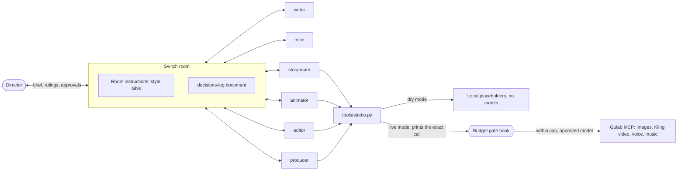

# Setup guide

This is the technical detail behind the [README](../README.md): how to run the full crew in Switch, how to turn on real generation, and how spending is limited.

Built and run on macOS (Apple silicon).

## What you need

- [Docker](https://docs.docker.com/get-started/get-docker/), running
- Claude Code, signed in with `claude auth login`
- Python 3, `ffmpeg` and Pillow (`pip3 install pillow`)

## Run the crew in Switch

**1. Check the tools.** This needs no Switch account and no credits.
```bash
python3 -m unittest discover tests
```

**2. Set up Switch.** [Install Switch Console](https://docs.switchagents.ai/switch-rooms/getting-started/install-switch-console), choose **On this computer** and start the local server.

**3. Create the crew.** Add the six agents in [`crew/agents.md`](../crew/agents.md), with this repository as each one's Directory. Turn Auto mode off for the animator. If you already made a crew from an earlier version, paste the updated storyboard, producer and animator instructions, and update the room's instructions.

**4. Create the room.** Under **Your Rooms**, choose **Create room**, pick Mattermost and paste [`crew/ROOM-INSTRUCTIONS.md`](../crew/ROOM-INSTRUCTIONS.md) into **Instructions**. Then add all six agents.

**5. Give the crew a brief.**
```text
@writer new production, slug try-01. A 12-second reel: Sita realises the golden deer is a trap.
```
Then rule on what the crew brings you.

## How the pieces connect



The agents share this repository for media files in `productions/<slug>/`. Decisions, handoffs and approvals go through the room.

## Dry mode and live mode

**Dry mode is the default and costs no credits.** You need no Gulab account. Stills are labelled cards showing the prompt, clips are slow zooms over them, and audio is silent. The crew's handoffs and your rulings all work as normal. The permission card on a paid `generate_video` call only appears in live mode, because dry mode never makes that call.

To go live:

1. Connect Gulab as a claude.ai connector on the account Claude Code uses, then check it appears:
   ```bash
   claude mcp list
   ```
2. In `studio.json`, set `"mode": "live"` and set `gulab_board` to a Gulab project id. The hosted reference sheets are already listed in `ref_urls`.
3. When the animator's card appears, choose **Allow once** on `generate_video`. **Allow for this session** is meant to stop asking for the rest of the session.

## How spending is limited

[`.claude/settings.json`](../.claude/settings.json) runs `studio.py gate` around every paid Gulab tool. The gate:

- blocks all paid tools in dry mode
- blocks any model `studio.json` doesn't list
- blocks any call that would pass `budget_usd`
- blocks a clip whose image isn't an approved still
- blocks music or voice lines longer than `limits` in `studio.json`
- blocks the call if the gate itself hits an error, such as a broken `studio.json` or ledger

The producer records each ruling with `studio.py approve` and `studio.py reject`, which write `productions/<slug>/approved.json`. Clips use the approved take, so a newer rejected take is never animated.

Spend is estimated from `rates_usd` and recorded in `productions/ledger.jsonl`. Neither run record is committed. Voice and music use a flat estimate, which is why their length is limited. In the real run the estimate came to about 50 cents above the true charge, so compare it with your Gulab balance.

`permissions.deny` in the same settings file stops agents changing `studio.json`, the ledger or the approvals with file tools or with shell commands like `sed`. It also applies to you if you ask Claude Code to make those edits, so change the cap in your own editor. These rules can't stop a script that opens the file itself, and an agent could record an approval you didn't give, so treat all of this as protection against mistakes.

If a hook can't start at all, for example because `python3` is missing, only the `onFailure` setting can block the call. That setting needs Claude Code 2.1.295 or later.
